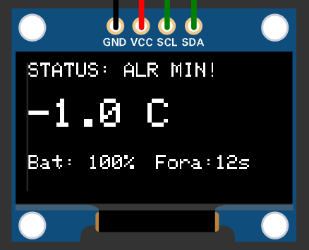
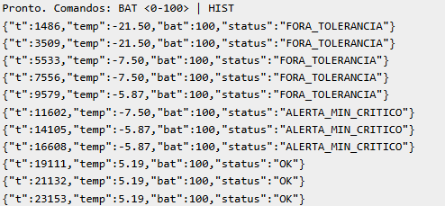
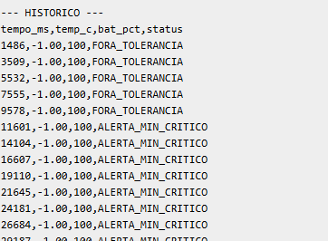
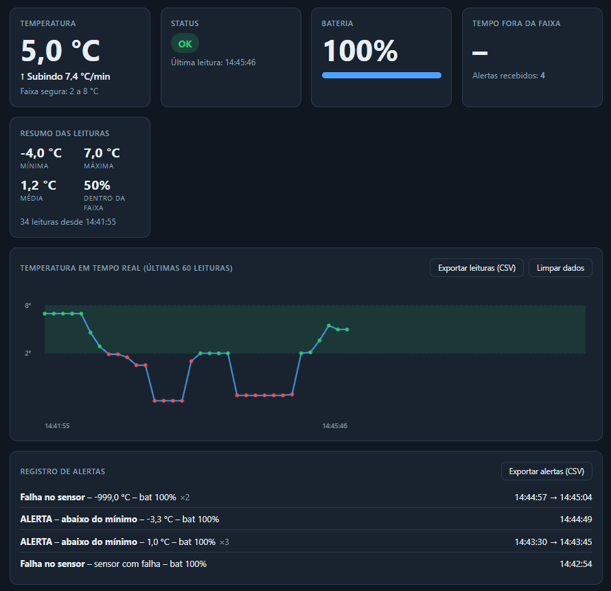

# ColdChain Monitor

Sistema embarcado simulado de **monitoramento de temperatura para ambientes industriais críticos** (câmaras frias, armazenamento de insumos sensíveis), desenvolvido para a disciplina de **Internet das Coisas (IoT)**.

O projeto roda inteiramente no simulador **[Wokwi](https://wokwi.com)**, sem hardware físico, e envia a telemetria por **MQTT** para um **dashboard web** em tempo real.

- Simulação sem MQTT (versão original): https://wokwi.com/projects/481403116305432577
- Simulação com MQTT: _cole aqui o link da sua cópia no Wokwi_
- Dashboard online: https://liamvitor.github.io/coldchain-monitor/ _(após ativar o GitHub Pages)_

## Arquitetura

```
Sensor DS18B20 → ESP32 → Wi-Fi / MQTT (HiveMQ) → Dashboard web → Alerta / Ação
                   │
                   ├─ Display OLED (status local)
                   └─ Buzzer (alerta sonoro local)
```

## Funcionalidades

### Firmware (ESP32)

- **Leitura contínua** da temperatura e verificação da faixa segura (2 a 8 °C).
- **Tolerância de tempo:** o alerta crítico só dispara após 10 s fora da faixa, evitando falsos alarmes por oscilações rápidas.
- **Alertas sonoros distintos:** 3 bips agudos e curtos para temperatura crítica; tom grave e longo para bateria baixa.
- **Display OLED** com temperatura, status, bateria e tempo fora da faixa.
- **Tratamento de falha de sensor** (desconexão ou leitura inválida).
- **Histórico circular** com 40 registros, consultável pela Serial.
- **Telemetria MQTT** em JSON, com tópico separado para alertas. Se o Wi-Fi ou o broker cair, o sistema continua funcionando offline e reconecta sozinho.

### Dashboard web

- **Temperatura atual com tendência** (↑ subindo, ↓ caindo em °C/min, ou → estável).
- **Status e banner de alerta** coloridos; o título da aba muda para 🔴 ALERTA quando há condição crítica.
- **Bateria** com barra de nível (fica vermelha em 20% ou menos).
- **Tempo fora da faixa** com barra de tolerância (10 s) até o alerta crítico.
- **Resumo das leituras:** mínima, máxima, média e percentual dentro da faixa.
- **Gráfico em tempo real** das últimas 60 leituras, com a faixa segura destacada, pontos vermelhos fora da faixa e tooltip ao passar o mouse.
- **Registro de alertas** (até 30), com contador e agrupamento: alertas iguais em menos de 15 s viram uma única linha (`×N`).
- **Indicador de conexão** com o broker e aviso de **dispositivo offline** quando não chegam dados há mais de 6 s.
- **Alerta sonoro opcional** (3 bips) para alerta crítico e falha de sensor. Vem desligado e é ativado pelo botão **Som**, pois o navegador exige um clique para liberar o áudio.
- **Exportação em CSV** das leituras e dos alertas (separador `;` e decimal `,`, abre direto no Excel em português).
- **Persistência no navegador:** até 500 leituras e 30 alertas ficam salvos no `localStorage` e voltam ao recarregar a página. O botão **Limpar dados** apaga tudo.

## Hardware simulado

| Componente | Pino do ESP32 |
|---|---|
| Sensor DS18B20 (com pull-up) | GPIO 4 |
| Display OLED SSD1306 (I2C) | SDA 21 / SCL 22 |
| Buzzer | GPIO 15 |


## Estrutura do projeto

```
README.md
firmware/                 # código do ESP32 para o Wokwi
├── sketch.ino
├── diagram.json
└── libraries.txt
docs/                     # dashboard web (publicado via GitHub Pages)
├── index.html
├── css/style.css
├── js/
│   ├── main.js           # ponto de entrada, liga módulos e botões
│   ├── config.js         # broker, prefixo dos tópicos e parâmetros
│   ├── mqtt.js           # conexão e assinatura dos tópicos
│   ├── data.js           # validação das mensagens e atualização do estado
│   ├── state.js          # estado da aplicação + localStorage
│   ├── ui.js             # cards, banner, log e indicador de conexão
│   ├── chart.js          # gráfico em canvas com tooltip
│   ├── sound.js          # alerta sonoro
│   ├── export.js         # exportação CSV
│   └── utils.js          # funções auxiliares
└── prints/               # imagens usadas neste README
```

## Como simular

1. Crie um projeto ESP32 no Wokwi e copie os arquivos da pasta `firmware/` (`sketch.ino`, `diagram.json` e `libraries.txt`).
2. Inicie a simulação. O ESP32 conecta na rede `Wokwi-GUEST` e publica no broker público `broker.hivemq.com`.
3. Abra o dashboard localmente (veja "Rodando o dashboard localmente" abaixo) ou pelo link online.
4. Clique no sensor DS18B20 no Wokwi e mude a temperatura para ver os estados do sistema.

### Rodando o dashboard localmente

O dashboard usa módulos JavaScript (`type="module"`), que os navegadores bloqueiam ao abrir `index.html` direto do disco (`file://`). Por isso, sirva a pasta `docs/` com um servidor local usando a extensão **Live Server** do VS Code: instale a extensão, clique com o botão direito em `docs/index.html` e escolha *Open with Live Server*.

É preciso ter internet, pois a biblioteca `mqtt.js` é carregada por CDN e a conexão com o broker é feita por WebSocket seguro (`wss://broker.hivemq.com:8884/mqtt`).

### Comandos pela Serial

| Comando | Efeito |
|---|---|
| `BAT <0-100>` | Define o nível de bateria simulado |
| `HIST` | Imprime o histórico de leituras em CSV |

## Tópicos MQTT

| Tópico | Conteúdo |
|---|---|
| `esp32-temp-monitor/telemetria` | Toda leitura (a cada ciclo, cerca de 1,2 s) |
| `esp32-temp-monitor/alerta` | Apenas alertas, bateria baixa e falha de sensor |

Formato da mensagem:

```json
{"t":3509,"temp":5.19,"bat":100,"status":"OK"}
```

Status possíveis: `OK`, `FORA_TOLERANCIA`, `ALERTA_MIN_CRITICO`, `ALERTA_MAX_CRITICO`, `BATERIA_BAIXA`, `FALHA_SENSOR`.

Em caso de `FALHA_SENSOR`, o campo `temp` vai como `-999.0` e o dashboard o exibe como `ERRO`.

## Configuração do dashboard

Os parâmetros ficam em `docs/js/config.js`:

| Constante | Padrão | Descrição |
|---|---|---|
| `BROKER` | `wss://broker.hivemq.com:8884/mqtt` | Endereço do broker (WebSocket seguro) |
| `PREFIX` | `esp32-temp-monitor` | Prefixo dos tópicos; deve ser igual ao do firmware |
| `TEMP_MIN` / `TEMP_MAX` | `2` / `8` | Faixa segura em °C; deve ser igual ao firmware |
| `TOL_S` | `10` | Tolerância do firmware, em segundos |
| `STALE_MS` | `6000` | Tempo sem dados para exibir o aviso de dispositivo offline |
| `MAX_PTS` | `60` | Leituras exibidas no gráfico |
| `KEEP` | `500` | Leituras guardadas no navegador |
| `GAP_MS` | `15000` | Janela para agrupar alertas iguais |

> O broker é público. Se quiser evitar mistura com mensagens de outras pessoas, troque `esp32-temp-monitor` por um prefixo mais único (ex.: `seunome/esp32-temp-monitor`) no `sketch.ino` (`TOPICO_TELEMETRIA` e `TOPICO_ALERTA`) e no `docs/js/config.js` (constante `PREFIX`).

## Demonstração

| Estado normal | Alerta ativo |
|---|---|
|  |  |

---

Telemetria JSON e histórico pela Serial:





---

Dashboard web:

