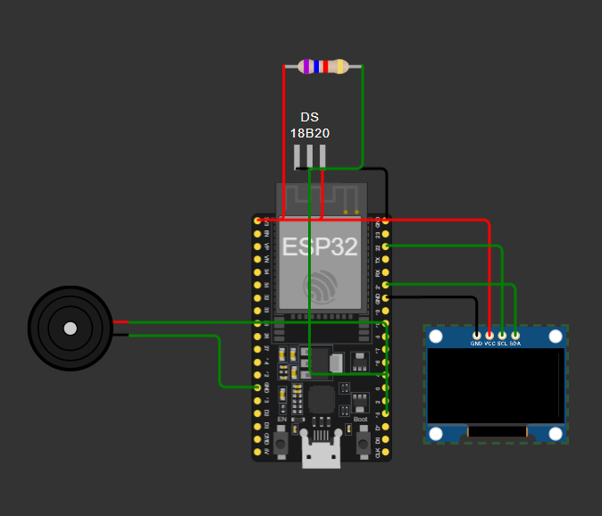
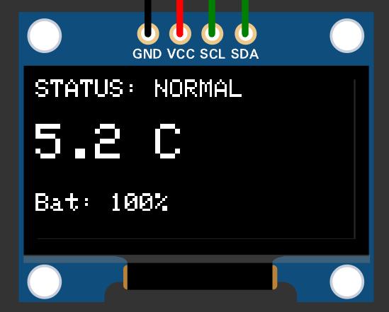

# ColdChain Monitor

Sistema embarcado simulado de **monitoramento de temperatura para ambientes industriais críticos** (câmaras frias, armazenamento de insumos sensíveis), desenvolvido para a disciplina de **Internet das Coisas (IoT)**.

O projeto roda inteiramente no simulador **[Wokwi](https://wokwi.com)**, sem hardware físico, e envia a telemetria por **MQTT** para um **dashboard web** em tempo real.

- Simulação sem MQTT (versão original): https://wokwi.com/projects/481245017381043201
- Simulação com MQTT: _cole aqui o link da sua cópia no Wokwi_
- Dashboard online: https://liamvitor.github.io/coldchain-monitor/ _(após ativar o GitHub Pages)_

## Arquitetura

```
Sensor DS18B20 → ESP32 → Wi-Fi / MQTT (HiveMQ) → Dashboard web → Alerta / Ação
                   │
                   ├─ Display OLED (status local)
                   └─ Buzzer (alerta sonoro local)
```

## Funcionalidades

- **Leitura contínua** da temperatura e verificação da faixa segura (2 a 8 °C).
- **Tolerância de tempo:** o alerta crítico só dispara após 10 s fora da faixa, evitando falsos alarmes por oscilações rápidas.
- **Alertas sonoros distintos:** 3 bips agudos e curtos para temperatura crítica; tom grave e longo para bateria baixa.
- **Display OLED** com temperatura, status, bateria e tempo fora da faixa.
- **Tratamento de falha de sensor** (desconexão ou leitura inválida).
- **Histórico circular** com 40 registros, consultável pela Serial.
- **Telemetria MQTT** em JSON, com tópico separado para alertas.
- **Dashboard web** com temperatura, status, bateria, gráfico em tempo real e registro de alertas.

## Hardware simulado

| Componente | Pino do ESP32 |
|---|---|
| Sensor DS18B20 (com pull-up) | GPIO 4 |
| Display OLED SSD1306 (I2C) | SDA 21 / SCL 22 |
| Buzzer | GPIO 15 |



## Como simular

1. Crie um projeto ESP32 no Wokwi e copie os arquivos da pasta `firmware/` (`sketch.ino`, `diagram.json` e `libraries.txt`).
2. Inicie a simulação. O ESP32 conecta na rede `Wokwi-GUEST` e publica no broker público `broker.hivemq.com`.
3. Abra o dashboard (link acima ou `docs/index.html` no navegador).
4. Clique no sensor DS18B20 no Wokwi e mude a temperatura para ver os estados do sistema.

### Comandos pela Serial

| Comando | Efeito |
|---|---|
| `BAT <0-100>` | Define o nível de bateria simulado |
| `HIST` | Imprime o histórico de leituras em CSV |

## Tópicos MQTT

| Tópico | Conteúdo |
|---|---|
| `liam/coldchain/telemetria` | Toda leitura (a cada ciclo) |
| `liam/coldchain/alerta` | Apenas alertas, bateria baixa e falha de sensor |

Formato da mensagem:

```json
{"t":3509,"temp":5.19,"bat":100,"status":"OK"}
```

Status possíveis: `OK`, `FORA_TOLERANCIA`, `ALERTA_MIN_CRITICO`, `ALERTA_MAX_CRITICO`, `BATERIA_BAIXA`, `FALHA_SENSOR`.

> O broker é público. Se quiser evitar mistura com mensagens de outras pessoas, troque `liam` por um prefixo único no `sketch.ino` e no `docs/index.html` (constante `PREFIX`).

## Demonstração

| Estado normal | Alerta ativo |
|---|---|
|  |  |

Telemetria JSON e histórico pela Serial:


